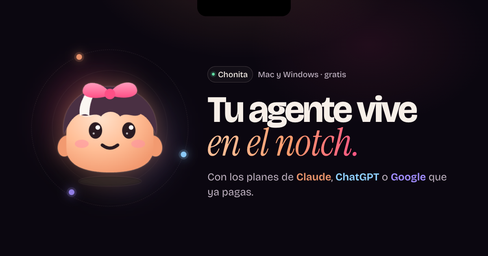

# Chonita

**Tu agente de escritorio vive en el notch.**
Le hablas o le escribes y resuelve tu correo, tu agenda, tus apps y tus archivos,
con los planes de Claude, ChatGPT o Google que ya pagas. Sin llaves de API.

[**Página de Chonita**](https://anndreloopez012.github.io/chonita-descargas/) ·
[**Descargar la última versión**](https://github.com/anndreloopez012/chonita-descargas/releases/latest) ·
[Todas las versiones](https://github.com/anndreloopez012/chonita-descargas/releases)

---

## Descargar

Entra a **[la última versión](https://github.com/anndreloopez012/chonita-descargas/releases/latest)** y baja el archivo de tu equipo:

| Tu equipo | Archivo | Requisitos |
|---|---|---|
| Mac con chip de Apple (M1 en adelante) | `Chonita-<versión>-arm64.dmg` | macOS 13 o más nuevo |
| Mac con Intel | `Chonita-<versión>-x64.dmg` | macOS 13 o más nuevo |
| Windows | `Chonita-<versión>-x64.exe` | Windows 10 u 11, 64 bits |

> **¿Qué chip tiene mi Mac?** Menú Apple → Acerca de esta Mac. Si dice «Chip Apple M…», es chip de Apple; si dice «Procesador Intel», es Intel.

## Instalar

<table>
<tr>
<th width="50%">En Mac</th>
<th width="50%">En Windows</th>
</tr>
<tr>
<td valign="top">

1. Abre el `.dmg` y arrastra Chonita a **Aplicaciones**.
2. La primera vez, macOS dice que no puede verificarla porque todavía no lleva el sello de Apple. Pulsa **Listo**.
3. Ve a **Ajustes del Sistema → Privacidad y seguridad**. Abajo aparece «Se bloqueó Chonita»: pulsa **Abrir igualmente**.
4. Chonita te guía para dar los permisos y conectar tus IA.

</td>
<td valign="top">

1. Abre el `.exe`.
2. Si aparece «Windows protegió tu PC», pulsa **Más información → Ejecutar de todas formas**. Sale porque el instalador todavía no va firmado.
3. Elige la carpeta y termina. Chonita queda en el menú Inicio.
4. Ábrela y conecta tus IA desde **Ajustes**.

</td>
</tr>
</table>

## Qué hace

| | |
|---|---|
| **Siempre a mano** | Pasa el mouse por el notch o pulsa <kbd>Alt</kbd> <kbd>Shift</kbd> <kbd>Espacio</kbd>. En Windows vive en una píldora arriba al centro. |
| **Tus tres IA** | Claude (con Claude Code), ChatGPT (con Codex) y Google (con Antigravity). Si una se queda sin cupo, sigue la otra. «Pregunta a las tres» para comparar. |
| **Al instante y sin gastar plan** | La hora, tu agenda de hoy, abrir o cerrar apps, volumen, modo oscuro, música, temporizadores y pomodoro. |
| **Controla tu equipo** | Apps, archivos, comandos, botones y menús de cualquier app, ventanas lado a lado y la página del navegador. |
| **Correo y reuniones** | Todas tus cuentas sin pedir contraseñas; resume y responde. En reuniones: resumen, nota, tareas y correo a los asistentes. |
| **Calendario, recordatorios y notas** | Tu agenda, recordatorios que llegan a tu iPhone, Apple Notes, Obsidian y Notas rápidas de Windows. |
| **Voz** | Manos libres con «Chonita…». Te entiende en tu equipo y el audio no se guarda. |
| **Dentro de tus apps** | Word, Excel, PowerPoint, VS Code, terminales, Git, Docker, WhatsApp y más: «esto» es lo que tienes abierto. |

## Tu equipo, tus reglas

- **Lo delicado se confirma:** enviar, borrar, sobrescribir, hacer push o correr comandos que modifican.
- **Tu voz se queda contigo:** se procesa en tu equipo y el audio no se guarda ni se envía.
- **Nunca escribe contraseñas**, ni las pide.
- **Páginas web con permiso:** antes de que una IA abra una página, Chonita te muestra la dirección y pregunta.
- **Lo tuyo se queda en tu equipo:** ajustes e historial viven ahí; solo sale lo que tú le mandas a tus IA.

## Preguntas

<b>¿Cuesta algo?</b>

Chonita es gratis. Lo que le pide a una IA se descuenta de tu plan de Claude, ChatGPT o Google, como si lo usaras directo. Lo simple no gasta plan.

<b>¿Qué necesito?</b>

Un Mac con macOS 13 o más nuevo, o una PC con Windows 10 u 11 de 64 bits, y al menos una cuenta de Claude, ChatGPT o Google con su plan. Chonita instala el programa oficial de cada una y te ayuda a conectarlo desde Ajustes.

<b>¿Se actualiza sola?</b>

Te avisa. Desde la versión 1.0.4 revisa este repositorio al abrirse y cada 6 horas, y te muestra un botón para descargar la versión nueva. No instala nada sin que lo decidas.

<b>¿Funciona igual en Windows?</b>

Casi todo. En lugar del notch vive en una píldora arriba al centro, el correo va por Outlook y las notas por Notas rápidas de Windows. Lo propio de macOS, como Apple Notes o los Atajos, no está.

## Sobre este repositorio

Aquí viven los **instaladores** de cada versión (en [Releases](https://github.com/anndreloopez012/chonita-descargas/releases)) y la **[página de Chonita](https://anndreloopez012.github.io/chonita-descargas/)** (`index.html` y `assets/`, publicada con GitHub Pages). El código de la app está en un repositorio privado.

 
Hecha con cariño por Andre Lopez.

